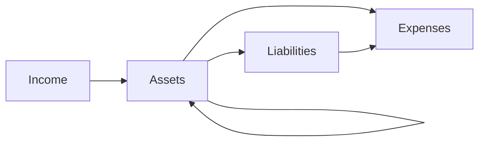

# Accounts

If you take a typical transaction, money moves between two parties. In
ledger, you call them **Account**. At least two accounts are involved
in any transaction. Accounts are also hierarchical. This helps with
organization. For example you can treat EPF and PPF as two
accounts namely `#!ledger Assets:Debt:EPF` and `#!ledger
Assets:Debt:PPF`. The hierarchy lets you ask questions like what is
the balance of `#!ledger Assets:Debt`, which includes both EPF and
PPF.

Even though **ledger** doesn't enforce an account naming
convention, Paisa relies on standard top-level names to distinguish spending, income, assets, and liabilities.

There are five top-level account types:

1. :fontawesome-solid-sack-dollar:{ .assets-color } Assets
1. :fontawesome-solid-credit-card:{ .liabilities-color } Liabilities
1. :fontawesome-solid-building:{ .income-color } Income
1. :fontawesome-solid-wallet:{ .expenses-color } Expenses
1. :fontawesome-solid-money-check-dollar:{ .equity-color } Equity

All the accounts you create should be under one of these
five prefixes. A transaction from `#!ledger Assets` to
`#!ledger Expenses` implies spending money, while `#!ledger Assets` to `#!ledger Assets` represents an investment or transfer.

Money typically flows from `#!ledger Income` to `#!ledger Assets`,
from `#!ledger Assets` to either `#!ledger Expenses`, `#!ledger
Liabilities`, or other `#!ledger Assets`, and from `#!ledger Liabilities`
to `#!ledger Expenses`.



As a general principle, try to keep second-level categories concise. The UI works best when you have around 12 or fewer
second-level accounts under each type (using 3<sup>rd</sup>-level sub-accounts such as `#!ledger Expenses:Food:Subway` for finer detail).

## Assets

All your assets should go under `#!ledger Assets:`. The recommended convention is
`#!ledger Assets:{instrument_type}:{instrument_name}` (e.g., `Cash`, `Equity`, `Debt`).

### Checking

`#!ledger Assets:Checking` (or any accounts matching `checking_accounts` in `paisa.yaml`, which supports wildcards like `Assets:Checking:*`) represents liquid cash accounts for daily use. They are included in net worth and displayed in the **Checking Balance** Dashboard widget, while investment gain/XIRR views exclude them.

### Inactive Accounts

Old or closed accounts can be hidden from active Asset Balance views using the **Filter Inactive** toggle by listing them under `inactive_accounts` (wildcards supported) or setting `inactive: true` on an entry in `accounts:` inside [Configuration](./config.md).

## Income

All your income should come from `#!ledger Income:`, such as `#!ledger Income:Salary:{company}`.

### Investment Income (Dividend, Interest, Distribution)

Paisa recognizes passive income prefixes to power [Investment Income](./income.md#investment-income), the Dashboard **Investment Income** widget, and total-return metrics on **Assets → Gain**:

- `#!ledger Income:Dividend:{name}` – stock and mutual fund dividends
- `#!ledger Income:Interest:{name}` – savings, FD, EPF, or bond interest (also used to compute debt/FD returns)
- `#!ledger Income:Distribution:{name}` / `#!ledger Income:Distributions:{name}` – fund or REIT distributions

### Capital Gains

```ledger
2018/03/01 Withdrawal
    Assets:Checking                  6775.49 INR
    Income:CapitalGains:Equity:NIFTY  -22.68 INR
    Assets:Equity:NIFTY               -100 NIFTY {67.5281 INR} [2018/01/01] @ 67.7549 INR
```

When you sell an asset for a gain or loss, record the profit/loss against `#!ledger Income:CapitalGains:{name}`.

## Expenses

All your expenses should go to `#!ledger Expenses:{category}`. You can nest deeper levels as needed; Paisa rolls them up to level 2 on monthly breakdowns and trend cards.

### Tax

Taxes paid (income tax, TDS, GST) should be posted to `#!ledger Expenses:Tax` (or sub-accounts such as `#!ledger Expenses:Tax:Income`). Paisa uses this to separate **Net Income** from **Gross Income**, compute savings rate accurately, and exclude tax payments from spending trend and FIRE living-expense baselines.

## Liabilities

### Credit Card

Credit card accounts should be named `#!ledger Liabilities:CreditCard:{name}`, such as `#!ledger Liabilities:CreditCard:Freedom`. See [Credit Cards](./credit-cards.md) for statement-cycle configuration.

## Equity

Equity is used to record opening balances or balance adjustments where money did not originate from Income or move to Expenses:

```ledger
2022/01/01 Opening Balance
    Assets:Checking:SBI       1000 INR
    Equity:OpeningBalance
```

## Icons

Each account is paired with an icon across tables, cards, and charts. Customize icons in **Tools → Configuration → Tools → Accounts** (`/more/config/accounts`). Paisa bundles four icon sets:

* [Arcticons](https://arcticons.onnno.nl/)
* [Font Awesome Regular, Solid and Brands](https://fontawesome.com/search?o=r&m=free&s=solid)
* [Material Design Icons](https://materialdesignicons.com/)
* [Fluent Emoji High Contrast](https://icon-sets.iconify.design/fluent-emoji-high-contrast/)

## Account Notes

You can attach a free-text note to any account (e.g., `"Emergency fund"`, `"Company 401k"`) without modifying your ledger files. Notes are stored in SQLite (`GET /api/account_notes`, `GET /api/account_notes/:account`, `POST /api/account_notes/upsert`, `POST /api/account_notes/delete`):

- Navigate to `/accounts/[name]` to compose, edit, or delete the account's note.
- On **Accounts → [name] → Transactions** (`/accounts/[name]/transactions`), existing notes appear inline in the header with a **Notes** button to edit them.

## Account-Level Transaction History

Clicking any account balance card on the Dashboard or an account row in Asset Balances opens `/accounts/[name]/transactions`, showing a filtered transaction history (with local date-range selector) for that account and any sub-accounts below it.

*(If you use Firefly III alongside Paisa, experimental balance comparison against Firefly III is available under Labs — see [Data Synchronization](./sync.md#firefly-iii-reconciliation-labs).)*
